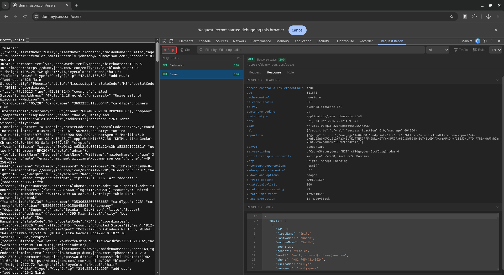
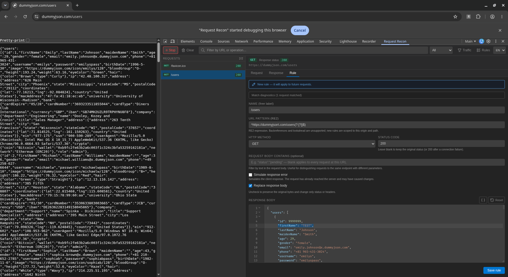
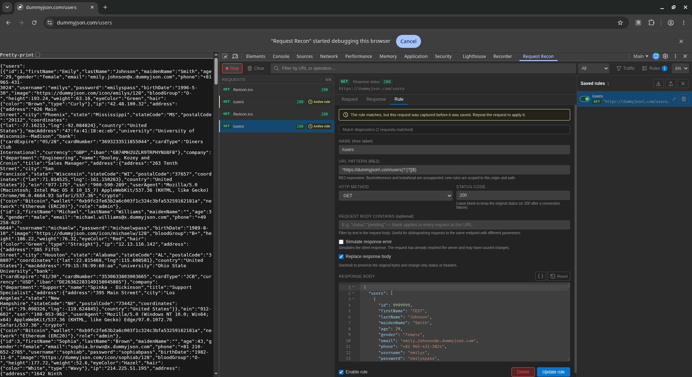
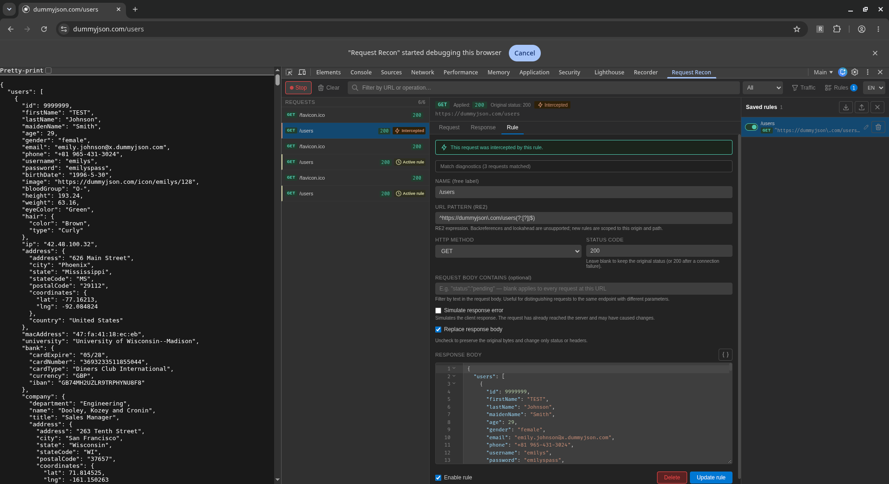
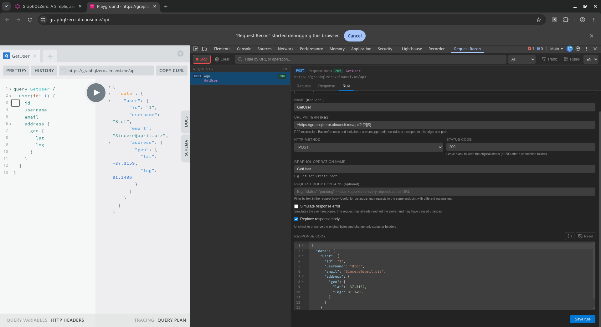
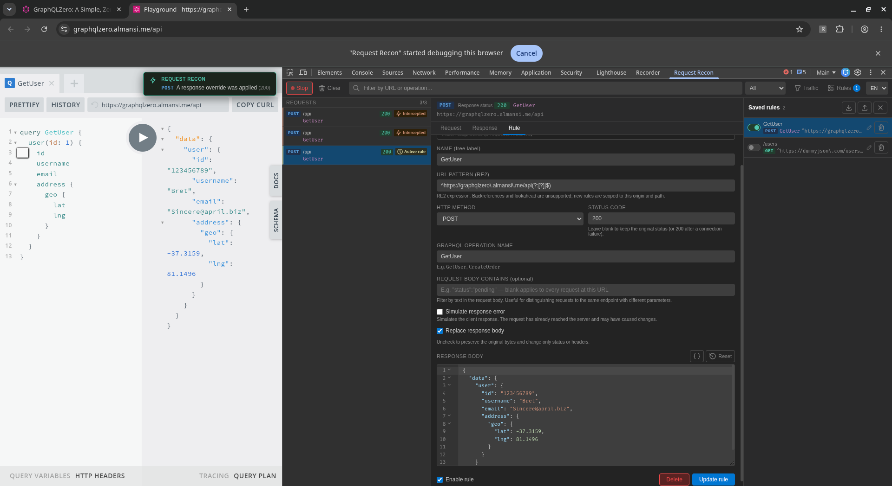

<p align="center">
  
</p>

<h1 align="center">Request Recon</h1>

<p align="center">Chrome DevTools extension for capturing requests and saving response override rules.</p>

## Screenshots

Inspect captured requests, response headers, and JSON bodies directly in Chrome DevTools.



<details>
<summary>REST response override workflow</summary>

Create a rule from a captured request and edit its replacement response body.



Save and manage rules in the sidebar. Repeat the request to apply a newly saved rule.



See the overridden response in the page and the intercepted request in the panel.



</details>

<details>
<summary>GraphQL response overrides</summary>

Match a GraphQL request by operation name and customize its response.



Repeat the operation to see the modified result and the override notification.



</details>

## Development

Requires Node.js 22.12+ and Chrome 118+.

```bash
npm ci
npm run dev
```

## Production build

```bash
npm run build
```

In `chrome://extensions`, enable Developer mode and use **Load unpacked** to select the generated `dist/` directory. Selecting the repository root loads unbuilt JSX and leaves the DevTools panel blank. After a rebuild, reload the extension and reopen DevTools.

## Traffic filters

The DevTools panel hides CORS preflights, static resources, and framework navigation payloads by default. Open **Traffic / Tráfico** to show any category or choose **Show all / Mostrar todo**. The visible/total count in the request list reflects URL and method search before traffic is hidden.

The filters only change the list: requests remain captured and response override rules still run. Failed requests and requests matched by an active rule stay visible. Visibility choices are saved in Chrome's local extension storage.

## Capture and response overrides

Capture runs while the DevTools panel is connected. Closing it stops capture and detaches the debugger after a two-second reconnect grace period. The popup also lets you stop all current capture sessions. Rules are shared across captured tabs; their URL match determines where they apply, including after navigation.

Response headers/status and network failures are captured without waiting for response bodies. Text bodies are collected after loading completes, up to 256 KiB per response. Binary data, event streams, and larger responses retain their metadata but omit body previews. The panel retains at most 1,000 requests and approximately 32 MiB of request data. Capture is best-effort when Chrome evicts a body or the pending-request budget is exceeded.

Request-body previews and body-filter matching use the first 64 KiB. GraphQL operation matching requires a complete JSON body within that limit. URLs longer than 16 KiB are not matched.

Rules apply at the response stage. An explicit replacement body is sent immediately, so the original upstream body is unavailable for that request. Uncheck **Replace response body** to preserve the original bytes when changing only status or headers. JSON response bodies are formatted when opening a rule or restoring a captured response. Further edits are saved as entered; use **Format JSON** to format them again. Press **Cmd+S / Ctrl+S** while the Rule tab is active to save or update the rule.

**Simulate response error** changes the client-visible result. The outbound request has already reached the server and can cause side effects; this feature does not prevent a POST or GraphQL mutation from running.

## Rules and imports

New request-derived URL patterns are anchored to the origin and exact path, while permitting different query parameters. Patterns use [RE2 syntax](https://github.com/google/re2/wiki/Syntax); backreferences and lookahead are unsupported. Unsupported or malformed saved rules are ignored with a warning, so they cannot block traffic. Legacy exact-URL rules remain supported.

Imports accept a legacy rule object/array or the versioned export format. Incoming rules are validated and start **disabled**. Enable them deliberately after reviewing their URL scope and replacement response. Import preserves file order and creates a new ID on a collision, retaining the existing rule. The first enabled matching rule in list order takes precedence.

Limits are 500 rules, 1 MiB per replacement body, and 8 MiB per import/export. Invalid status codes, headers, field types, patterns, and duplicate IDs in one file are rejected. All rule mutations are serialized by the service worker; success messages appear only after storage succeeds.

Rules, response fixtures, and request-body filters are saved locally in extension storage. Exports include these values verbatim and can contain personal data or credentials; review files before sharing. Inspected-page notifications show a generic label rather than rule names or URLs. No request data is uploaded by this extension.

## Verification

```bash
npm test
npm run build
npm audit
```

Tests exercise debugger lifecycle failures, paused-request recovery, streaming and body-size policies, binary preservation, concurrent mutations, import validation/order, command acknowledgements, matching, and UI helpers. CI runs tests, the production build, and the dependency audit.

## Languages

The panel and extension popup support English and Spanish. They start in the browser's language (English for other browser languages). Use the **EN / ES** selector in the panel or the language selector in the popup to change it. The choice is saved in Chrome's local extension storage and shared between both views.

## License

Request Recon source code is licensed under the Mozilla Public License 2.0; see [LICENSE](LICENSE). Third-party assets and libraries retain their own licenses. Tabler Icons and bundled library notices are in [THIRD_PARTY_NOTICES.txt](THIRD_PARTY_NOTICES.txt). Both notice files are included in the built extension.
